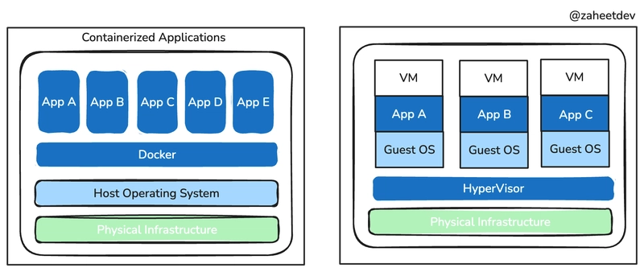

# Conteneurisation

## J1
### Commande de base de terminal

```bash

pwd                                 # Affiche le répertoire de travail actuel
ls -la                              # Liste les fichiers et dossiers dans le répertoire actuel avec des détails
cd <dossier>                        # Change le répertoire de travail actuel vers <répertoire>

curl -i http://localhost:8080       # Effectue une requête HTTP GET vers l'URL spécifiée et affiche les en-têtes de réponse (-i = inclure les en-têtes)
```

```bash
# Construire l'image Docker à partir du Dockerfile
docker build -t nom_de_l_image .

# Lister les images Docker disponibles
docker images

# Lister les conteneurs en cours d'exécution
docker ps

# Lister tous les conteneurs (en cours d'exécution et arrêtés)
docker ps -a

# Démarrer un conteneur à partir d'une image
docker run -d --name nom_du_conteneur nom_de_l_image

# Arrêter un conteneur en cours d'exécution
docker stop nom_du_conteneur

# Supprimer un conteneur
docker rm nom_du_conteneur

# Supprimer une image Docker
docker rmi nom_de_l_image

docker run -d -p 80:80 docker/getting-started  # Démarrer un conteneur en arrière-plan et mapper le port 80 du conteneur au port 80 de l'hôte

docker build -t mon_image .  # Construire une image Docker à partir du Dockerfile dans le répertoire actuel et la nommer "mon_image"
```

### prise de note générale

- Docker est un outil de conteneurisation qui permet de créer, déployer et gérer des applications dans des conteneurs.
- Un conteneur est une instance isolée d'une application qui inclut tout ce qui est nécessaire pour l'exécuter, y compris le code, les dépendances et la configuration.
- Un image Docker est un fichier statique qui contient toutes les informations nécessaires pour créer un conteneur.
- Le fichier Dockerfile est utilisé pour définir comment construire une image Docker.
- La commande `docker build` permet de construire une image à partir d'un Dockerfile.
- La commande `docker run` permet de démarrer un conteneur à partir d'une image.
    - L'option `-d` permet de démarrer le conteneur en arrière-plan (mode détaché).
    - L'option `--name` permet de donner un nom au conteneur.
    - L'option `-p` permet de mapper un port du conteneur à un port de l'hôte.
- La commande `docker ps` permet de lister les conteneurs en cours d'exécution.
- La commande `docker ps -a` permet de lister tous les conteneurs (en cours d'exécution et arrêtés).
- La commande `docker stop` permet d'arrêter un conteneur en cours d'exécution.
- La commande `docker rm` permet de supprimer un conteneur.
- La commande `docker rmi` permet de supprimer une image Docker.

### Trois objets à dinstinguer

- image : un fichier statique qui contient tout ce qui est nécessaire pour créer un conteneur.
- conteneur : une instance en cours d'exécution d'une image Docker.
- Dockerfile : un fichier texte qui contient les instructions pour construire une image Docker.


### Docker vs VM



### Ce que apporte Docker au projet

- Décrire les dépendances d'éxecution
- Construire une version et la distribuer via un registre (DockerHub, GitHub Container Registry, etc.)
- Lanceer plusieurs instances sans réinstaller l'application

### Important pour MAC

Pour pull sur render, il faut que ça soit en amd64.

```bash
docker buildx build --platform linux/amd64 -t <image_name> .

docker push <image_name>
```
### Installer docker sur machine ssh debian

```bash
apt install -y docker.io
systemctl enable docker
systemctl start docker
```
#### récuperr une image depuis dockerhub

```bash
docker pull jacma38/app-dodo
```
et run cette image pour y accéder en ligne de commande

```bash
docker run -dp 40269:3000 jacma38/app-dodo
```

#### Installer portainer

```bash
docker pull portainer/portainer
docker volume create portainer_data
docker run -dp 443:9443 --name portainer --restart=always -v /var/run/docker.sock:/var/run/docker.sock -v portainer_data:/data portainer/portainer
```

### Construire un Dockerfile

Exemple de la J1 : le Dockerfile de l'application « todo » (`app/Dockerfile`), une app Node/Express qui écoute sur le port 3000.

```dockerfile
FROM node:24-alpine
WORKDIR /app
COPY package*.json .
RUN yarn install --production
COPY . .
EXPOSE 3000
CMD ["node", "src/index.js"]
```

Chaque instruction crée une **couche** de l'image :

| Instruction | Rôle | Dans l'exemple |
|---|---|---|
| `FROM` | Image de départ | `node:24-alpine` : Node.js sur Alpine Linux, une base très légère |
| `WORKDIR` | Dossier de travail dans l'image (créé s'il n'existe pas) | `/app` |
| `COPY` | Copie des fichiers de la machine vers l'image | d'abord `package*.json`, puis tout le code |
| `RUN` | Exécute une commande **pendant le build** | `yarn install --production` installe les dépendances |
| `EXPOSE` | Documente le port d'écoute (ne publie rien, c'est `-p` qui publie) | `3000` |
| `CMD` | Commande lancée **au démarrage du conteneur** | `node src/index.js` |

Points importants :

- **Ordre des instructions et cache** : on copie d'abord `package*.json`, on installe les dépendances, et seulement ensuite on copie le code (`COPY . .`). Tant que les dépendances ne changent pas, Docker réutilise le cache et le rebuild est rapide.
- **`--production`** : n'installe que les `dependencies` et ignore les `devDependencies` (`jest`, `nodemon`, `prettier`). L'image est plus légère.
- **`RUN` ≠ `CMD`** : `RUN` s'exécute une fois à la construction de l'image, `CMD` à chaque démarrage d'un conteneur.
- **Port** : l'app fait `app.listen(3000)`. C'est ce port de conteneur qu'on relie à un port de l'hôte, comme dans `docker run -dp 40269:3000 jacma38/app-dodo`.
- **`.dockerignore`** : liste ce qui ne doit pas être copié par `COPY . .` (`node_modules`, `.git`). Celui de `app/` est vide pour l'instant.

Construire et lancer cette image :

```bash
docker build -t app-dodo .
docker run -dp 3000:3000 app-dodo
```

### Persistance des données

- `src/persistence/index.js` choisit la base : **MySQL** si la variable d'environnement `MYSQL_HOST` est définie, sinon **SQLite**, dont le fichier est dans `/etc/todos/todo.db`.
- Ce fichier est dans le système de fichiers du conteneur : si on supprime le conteneur (`docker rm`), les données disparaissent. Un **volume** permet de les garder en dehors du conteneur.

```bash
docker run -dp 3000:3000 -v todo-db:/etc/todos app-dodo   # volume nommé monté sur le dossier de la base
```

### Commandes utiles en plus

```bash
docker logs nom_du_conteneur         # Affiche les logs du conteneur (-f pour les suivre)
docker exec -it nom_du_conteneur sh  # Ouvre un shell dans un conteneur en cours d'exécution
```

## Résumé J1

La conteneurisation avec Docker permet de créer, distribuer et exécuter une application dans un environnement isolé et reproductible. Une image sert de modèle, un conteneur est une instance de cette image, et le Dockerfile décrit sa construction.

Les commandes essentielles permettent de construire une image (`docker build`), de lancer et gérer des conteneurs (`docker run`, `docker ps`, `docker stop`, `docker rm`) ainsi que de gérer les images (`docker images`, `docker rmi`). Les ports peuvent être exposés avec l'option `-p`.

Pour déployer sur Render depuis un Mac, l'image doit être construite pour la plateforme `linux/amd64`, puis publiée dans un registre. La séance a également abordé l'installation de Docker sur Debian, la récupération d'une image Docker Hub et l'installation de Portainer pour administrer les conteneurs.

## J2

TP fourni par le prof (`raccourcis-template`) : une application de fiches de raccourcis clavier, avec un **backend** Flask (port 5000) et un **frontend** Vite (port 5173). Aucun Dockerfile ni fichier Compose n'est fourni : il faut **dockeriser** l'application, la lancer avec Docker Compose, puis la déployer automatiquement sur un VPS avec GitHub Actions.

### Dockeriser le TP

Un Dockerfile par service.

`backend/Dockerfile` :

```dockerfile
FROM python:3.12-alpine
WORKDIR /app
COPY requirements.txt .
RUN pip install -r requirements.txt
COPY . .
CMD ["flask", "--app", "app", "run", "--host=0.0.0.0", "--port=5000"]
```

`frontend/Dockerfile` :

```dockerfile
FROM node:22-alpine
WORKDIR /app
COPY package*.json ./
RUN npm ci
COPY . .
EXPOSE 5173
CMD ["npm", "run", "dev"]
```

- Même schéma que la J1 : dépendances d'abord (cache), code ensuite. Ici `pip install` côté Python et `npm ci` côté Node.
- **`--host=0.0.0.0`** : dans un conteneur, une application qui écoute sur `127.0.0.1` n'est pas joignable de l'extérieur. Flask doit écouter sur toutes les interfaces (Vite le fait via `host: '0.0.0.0'` dans `vite.config.js`).
- **Chemin de `content/`** : le backend lit `Path(__file__).parent.parent / "content"`, donc le dossier qui contient `backend/`. Dans l'image, `app.py` est dans `/app/`, il lit donc **`/content`**.
- **`.dockerignore`** : à placer dans chaque dossier de build (le contexte est `./backend` et `./frontend`). Il faut y exclure `node_modules`, `.git`, `.venv` et `dist`, sinon un `node_modules` local peut être copié dans l'image.
- **`COPY` avec plusieurs fichiers** : la destination doit finir par `/` (`COPY package*.json ./`). BuildKit (Docker récent) est tolérant, mais l'ancien builder du VPS échoue.

### Docker Compose

Compose décrit plusieurs conteneurs dans un seul fichier (`compose.yaml`), au lieu de lancer chaque `docker run` à la main.

```yaml
services:
  backend:
    build:
      context: ./backend
    ports:
      - "5001:5000"
    volumes:
      - ./content:/content

  frontend:
    build:
      context: ./frontend
    ports:
      - "40244:5173"
    environment:
      API_PROXY_TARGET: http://backend:5000
    depends_on:
      - backend
```

| Clé | Rôle |
|---|---|
| `build.context` | Dossier qui contient le Dockerfile du service |
| `image` | Utilise une image existante au lieu de la construire |
| `ports` | `"hôte:conteneur"` : port ouvert sur la machine → port dans le conteneur |
| `volumes` | `./dossier_hôte:/chemin_conteneur` |
| `environment` | Variables d'environnement du conteneur |
| `depends_on` | Ordre de démarrage (il attend le démarrage, pas que l'app soit prête) |

```bash
docker compose up               # Crée et démarre les services
docker compose up -d --build    # En arrière-plan, en reconstruisant les images
docker compose down             # Arrête et supprime les conteneurs et le réseau
docker compose ps               # État des services
docker compose logs --tail=20   # Dernières lignes de logs
docker compose config           # Valide le fichier et affiche la config finale
```

### Réseau entre conteneurs

- Compose crée un réseau interne. Les services s'y joignent **par leur nom** : le frontend appelle `http://backend:5000`.
- Dans un conteneur, `127.0.0.1` désigne **le conteneur lui-même**, pas la machine ni un autre conteneur.
- Sur le réseau interne, on utilise le **port du conteneur** (`5000`). Le port de gauche dans `ports` (`5001`) ne sert qu'à accéder depuis la machine hôte.
- Ici, le navigateur n'appelle jamais le backend directement : il appelle `/api/...` sur le frontend, et le proxy de Vite (`API_PROXY_TARGET`) redirige vers le backend.

### Erreurs rencontrées

| Erreur | Cause | Solution |
|---|---|---|
| `build additional properties 'platform' not allowed` | Sous `build:`, la clé s'appelle `platforms` (liste). `platform` (chaîne) n'existe qu'au niveau du service | Supprimer la ligne, ou utiliser `platforms:` |
| `bind: address already in use` sur le port 5000 | Sur Mac, le Récepteur AirPlay occupe le port 5000 (`lsof -nP -iTCP:5000`) | Changer le port hôte (`5001:5000`) |
| `port is already allocated` | Un autre conteneur utilise déjà ce port (`docker ps`) | `docker stop` ce conteneur ou changer de port |
| « Aucune fiche trouvée » alors que le volume est monté | Le code lit `/content` (dossier parent de `app.py`) mais le volume était monté sur `/app/content` | Monter sur `/content` |

Commandes de diagnostic :

```bash
lsof -nP -iTCP:5000 -sTCP:LISTEN         # Quel processus écoute sur ce port
docker ps --filter "publish=5173"        # Quel conteneur publie ce port
docker compose exec backend ls /content  # Ce que voit réellement le conteneur
curl -s localhost:5001/api/shortcuts     # Tester l'API directement
```

### Déploiement automatique avec GitHub Actions

Objectif : à chaque `push` sur `main`, le VPS récupère le code et reconstruit les conteneurs.

```
push sur main → GitHub Actions → connexion SSH au VPS → git pull → docker-compose up -d --build
```

Workflow `.github/workflows/deploy.yml` :

```yaml
name: Deploy

on:
  push:
    branches: [main]

jobs:
  deploy:
    runs-on: ubuntu-latest
    steps:
      - name: Mise à jour et build sur le VPS
        uses: appleboy/ssh-action@v1.0.3
        with:
          host: ${{ secrets.VPS_HOST }}
          username: ${{ secrets.VPS_USER }}
          key: ${{ secrets.VPS_SSH_KEY }}
          script: |
            cd ${{ secrets.VPS_PATH }}
            git pull origin main
            docker-compose down
            docker-compose up -d --build
```

**Préparation du VPS**

1. Créer un utilisateur dédié plutôt que d'utiliser `root` :
   ```bash
   adduser deploy
   usermod -aG docker deploy   # permet d'utiliser Docker sans sudo
   ```
2. Donner à cet utilisateur une clé GitHub (**deploy key** en lecture seule : Settings → Deploy keys) et cloner le dépôt en SSH dans son dossier personnel.
3. Créer une clé SSH réservée au déploiement sur son ordinateur, puis l'installer sur le VPS :
   ```bash
   ssh-keygen -t ed25519 -f ~/.ssh/deploy_raccourcis -N ""
   ssh-copy-id -i ~/.ssh/deploy_raccourcis.pub deploy@IP_DU_VPS
   ```
4. Installer Compose si besoin (sur ce VPS : `docker-compose` v1, avec un tiret).

**Secrets GitHub** (Settings → Secrets and variables → Actions → *Repository secrets*) :

| Secret | Valeur |
|---|---|
| `VPS_HOST` | IP ou domaine du VPS |
| `VPS_USER` | utilisateur SSH (`deploy`) |
| `VPS_SSH_KEY` | contenu de la **clé privée** |
| `VPS_PATH` | chemin du clone sur le VPS |

- Un secret créé après le lancement d'un run n'est pas pris en compte par ce run.
- Un « Re-run » rejoue l'**ancienne** version du workflow. Pour tester une correction du fichier, il faut un nouveau commit.
- Ne jamais écrire de mot de passe, de token ou de clé privée dans le dépôt.

### Problèmes rencontrés sur le VPS

| Symptôme | Cause | Solution |
|---|---|---|
| `Error: missing server host` | Le secret `VPS_HOST` est vide ou absent au moment du run | Vérifier les *Repository secrets*, puis relancer |
| `'compose' is not a docker command` / `unknown shorthand flag: 'd'` | Le plugin Compose v2 n'est pas installé | Installer un paquet Compose (`docker-compose` v1 ici) et adapter la commande du workflow |
| `COPY ... the destination must be a directory and end with a /` | Ancien builder du VPS plus strict | `COPY package*.json ./` |
| Le site « met trop de temps à répondre » alors que `curl localhost` renvoie 200 | Un pare-feu (ici celui de l'école) bloque le port depuis Internet | Publier sur un port autorisé |

- **`docker compose` (v2, plugin) ≠ `docker-compose` (v1, binaire séparé)** : la syntaxe est la même, seul le nom de la commande change.
- Diagnostic : si l'application répond en local sur le VPS mais pas depuis l'extérieur, le problème est **réseau**, pas applicatif. Un *timeout* indique que les paquets sont jetés par un pare-feu, alors qu'un *connection refused* indique que rien n'écoute.
- Sur ce VPS, seuls certains ports sont ouverts (plage **40100 à 40300**). Le site est donc publié avec `"40244:5173"`.
- Docker, la mise à jour du code et la reconstruction ont lieu **sur le VPS** : il n'y a pas de registre dans ce montage, contrairement à la méthode de la J1 (build, push, pull).
- Attention : ce compose lance Vite et Flask **en mode développement**. Ça fonctionne, mais une vraie production utiliserait des fichiers statiques servis par un serveur web et un serveur WSGI (gunicorn).

## Résumé J2

Docker Compose décrit plusieurs services dans un seul fichier : build, ports, volumes, variables d'environnement. Les conteneurs communiquent par leur nom de service sur un réseau interne, et chaque `127.0.0.1` désigne le conteneur lui-même. Un port publié (`hôte:conteneur`) peut entrer en conflit avec un autre processus ou conteneur, et un volume doit être monté exactement là où le code lit ses fichiers.

Le déploiement continu repose sur GitHub Actions : à chaque push sur `main`, un workflow se connecte en SSH à un VPS avec une clé dédiée stockée dans les secrets GitHub, met à jour le code avec `git pull` et relance `docker-compose up -d --build`. Il faut un utilisateur dédié (pas `root`), une deploy key pour cloner, et une version de Compose compatible avec le serveur.

Un site déployé n'est joignable que si le port publié est autorisé par le pare-feu : si l'application répond en local mais pas depuis Internet, on change de port plutôt que de modifier le code.

